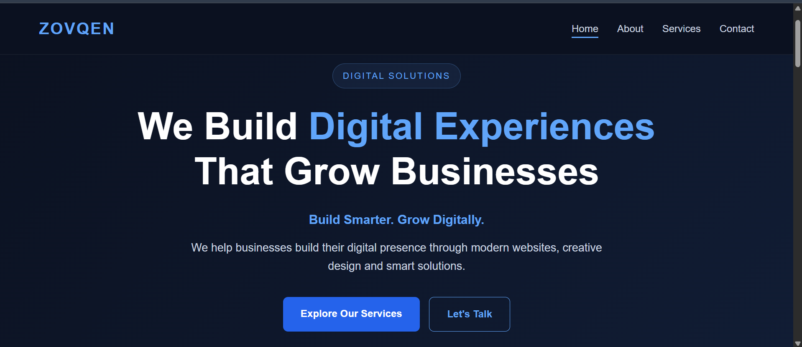
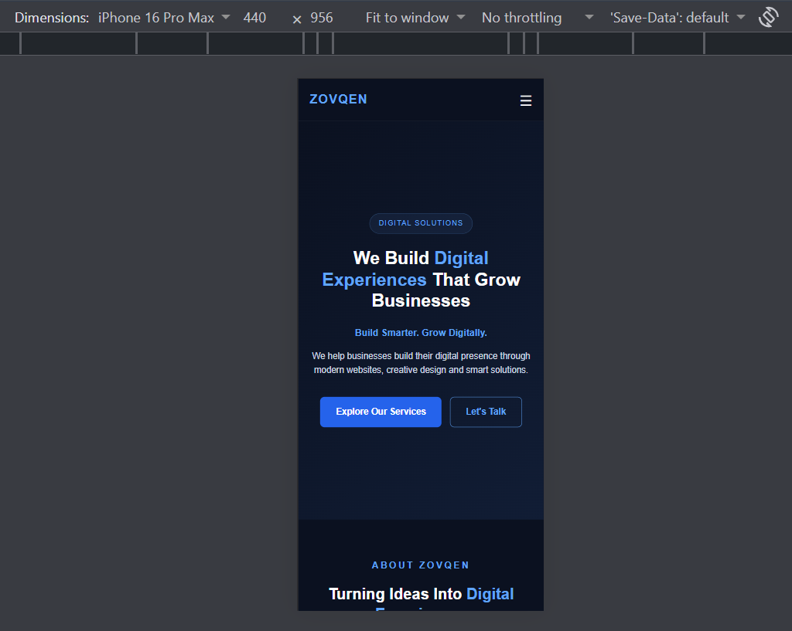

# ZOVQEN – Digital Solutions

A responsive business website built using HTML, CSS, and JavaScript for a fictional digital solutions company.

## Features

- Responsive website design
- Navigation menu
- JavaScript mobile menu
- Services section with six services
- About section
- Customer inquiry form with basic validation
- Testimonials section with three sample reviews
- Responsive layout for desktop, tablet, and mobile
- Modern dark-themed UI

## Technologies Used

- HTML5
- CSS3
- JavaScript
- Font Awesome

## Project Structure

Zovqen/
├── index.html
├── style.css
├── script.js
├── README.md
└── screenshots/
    ├── desktop.png
    └── mobile.png

## Week 1

Created the initial responsive business website, including Home, About, Services, and Contact sections with navigation and responsive styling.

## Week 2 Improvements

- Improved Services section
- Verified navigation functionality
- Tested mobile navigation menu
- Added customer inquiry form with validation
- Added three sample testimonials
- Tested website on desktop, tablet, and mobile screen sizes
- Fixed layout and styling issues

## Screenshots

### Desktop View

### Mobile View

## GitHub Repository

[View Project on GitHub](https://github.com/Safdar-Ali9911/zovqen-business-website)